# Hemotrack · Rota Vital — Trabalho U2 · Parte 2

Planejamento da remodelagem do Rota Vital: DDD, arquitetura em três camadas, projeção com microsserviços e três cenários com orçamento.
Infraestrutura de Software · ADS · CESAR School · 2026.2

## Equipe

| Integrante | Papel |
| --- | --- |
| Ewerton Guilherme da Silva | Product Owner |
| Pablo Arthur Eustáquio de Lima | Backend Developer |
| João Ricardo Alves de Brito | Backend Developer |
| Lucas Aprigio dos Santos | Backend Developer |
| Saulo Eduardo Almeida dos Santos | Backend Developer |
| Thiago Cardozo da Conceição | Frontend / UI Designer |
| Eloi de Lima Sousa | Frontend / UI Designer |

## Entregas

### Pré-entrega · 17/11, até 19h15 (seções A e C)

📄 **Arquivo para o Classroom:** [`Hemotrack-Pre-entrega-Secoes-A-e-C.pdf`](docs/entregas/Hemotrack-Pre-entrega-Secoes-A-e-C.pdf)

| Seção | Conteúdo | Arquivos de apoio |
| --- | --- | --- |
| [Identificação e premissas](docs/arquitetura/documento.md#identificação-e-premissas) | Squad, sistema, dados sintéticos | — |
| [A. Remodelagem do domínio com DDD](docs/arquitetura/documento.md#a-remodelagem-do-domínio-com-ddd) | [Subdomínios](docs/arquitetura/documento.md#a1-subdomínios) · [Bounded contexts](docs/arquitetura/documento.md#a2-bounded-contexts) · [Glossário](docs/arquitetura/documento.md#a3-glossário-da-linguagem-ubíqua) · [Mapa de contextos](docs/arquitetura/documento.md#a4-mapa-de-contextos) | [`mapa-de-contextos.mmd`](docs/arquitetura/contexto/mapa-de-contextos.mmd) · [PNG](docs/arquitetura/img/mapa-de-contextos.png) |
| [C. Arquitetura em três camadas](docs/arquitetura/documento.md#c-arquitetura-em-três-camadas) | [O que fica em cada camada](docs/arquitetura/documento.md#c1-o-que-fica-em-cada-camada) · [Regra de dependência](docs/arquitetura/documento.md#c2-regra-de-dependência) · [Estrutura de pacotes](docs/arquitetura/documento.md#c3-estrutura-de-pacotes) · [Camada lógica × tier físico](docs/arquitetura/documento.md#c4-camada-lógica--tier-físico) | [`regra-de-dependencia.mmd`](docs/arquitetura/camadas/regra-de-dependencia.mmd) · [PNG](docs/arquitetura/img/regra-de-dependencia.png) |

### Entrega final e apresentação · 24/11

📄 **Arquivos para o Classroom:** [`Hemotrack-Rota-Vital-Parte-2.pdf`](docs/entregas/Hemotrack-Rota-Vital-Parte-2.pdf) (10 páginas, limite de 12) · [`Hemotrack-Rota-Vital-Parte-2-Slides.pdf`](docs/entregas/Hemotrack-Rota-Vital-Parte-2-Slides.pdf) (16 slides)

| Seção | Conteúdo | Arquivos de apoio |
| --- | --- | --- |
| [A. Remodelagem do domínio com DDD](docs/arquitetura/documento.md#a-remodelagem-do-domínio-com-ddd) | [Subdomínios](docs/arquitetura/documento.md#a1-subdomínios) · [Bounded contexts](docs/arquitetura/documento.md#a2-bounded-contexts) · [Glossário](docs/arquitetura/documento.md#a3-glossário-da-linguagem-ubíqua) · [Mapa de contextos](docs/arquitetura/documento.md#a4-mapa-de-contextos) | [`mapa-de-contextos.mmd`](docs/arquitetura/contexto/mapa-de-contextos.mmd) · [PNG](docs/arquitetura/img/mapa-de-contextos.png) |
| [B. Modelo tático do contexto Requisição](docs/arquitetura/documento.md#b-modelo-tático-do-contexto-requisição-core) | [Agregado Requisição](docs/arquitetura/documento.md#b1-agregado-requisição) · [História de usuário](docs/arquitetura/documento.md#b2-história-de-usuário-âncora) · [Cenário Gherkin](docs/arquitetura/documento.md#b3-cenário-gherkin-executado-na-parte-3) | [`agregado-requisicao.mmd`](docs/arquitetura/contexto/agregado-requisicao.mmd) · [PNG](docs/arquitetura/img/agregado-requisicao.png) · [`alocar_bolsa.feature`](features/alocar_bolsa.feature) |
| [C. Arquitetura em três camadas](docs/arquitetura/documento.md#c-arquitetura-em-três-camadas) | [O que fica em cada camada](docs/arquitetura/documento.md#c1-o-que-fica-em-cada-camada) · [Regra de dependência](docs/arquitetura/documento.md#c2-regra-de-dependência) · [Estrutura de pacotes](docs/arquitetura/documento.md#c3-estrutura-de-pacotes) · [Camada lógica × tier físico](docs/arquitetura/documento.md#c4-camada-lógica--tier-físico) | [`regra-de-dependencia.mmd`](docs/arquitetura/camadas/regra-de-dependencia.mmd) · [PNG](docs/arquitetura/img/regra-de-dependencia.png) |
| [D. Projeção com microsserviços](docs/arquitetura/documento.md#d-projeção-com-microsserviços) | [Serviços](docs/arquitetura/documento.md#d1-quais-contextos-viram-serviços) · [Comunicação e dados](docs/arquitetura/documento.md#d2-comunicação-e-dados) · [Saga](docs/arquitetura/documento.md#d3-saga-atender-requisição-orquestrada-pela-requisição) · [Comparação](docs/arquitetura/documento.md#d4-comparação-para-o-rota-vital) · [ADRs](docs/arquitetura/documento.md#d5-adrs) | [`comunicacao.mmd`](docs/arquitetura/microsservicos/comunicacao.mmd) · [`saga-atender-requisicao.mmd`](docs/arquitetura/microsservicos/saga-atender-requisicao.mmd) · [ADR 0001](docs/arquitetura/adr/0001-decomposicao.md) · [ADR 0002](docs/arquitetura/adr/0002-eventos-com-outbox.md) |
| [E. Três cenários com orçamento](docs/arquitetura/documento.md#e-três-cenários-com-orçamento) | [Premissas de carga](docs/arquitetura/documento.md#e1-premissas-de-carga) · [Lei de Little](docs/arquitetura/documento.md#e2-lei-de-little) · [Diagramas](docs/arquitetura/documento.md#e3-diagramas-e-o-que-muda) · [Orçamento](docs/arquitetura/documento.md#e4-orçamento-por-cenário) | [`orcamento.xlsx`](docs/arquitetura/orcamento.xlsx) · [`baixo.mmd`](docs/arquitetura/cenarios/baixo.mmd) · [`moderado.mmd`](docs/arquitetura/cenarios/moderado.mmd) · [`alto.mmd`](docs/arquitetura/cenarios/alto.mmd) |
| [Uso de IA](docs/arquitetura/documento.md#uso-de-ia) · [Referências](docs/arquitetura/documento.md#referências) | O que foi feito pela IA e pelo squad; fontes de preço | — |

**Apresentação:** [`roteiro.md`](docs/apresentacao/roteiro.md) (divisão por integrante, contas e perguntas prováveis) · **Pendências:** [`PENDENCIAS.md`](docs/PENDENCIAS.md)

## Estrutura

```
docs/
├── entregas/                             # PDFs para o Classroom
│   ├── Hemotrack-Pre-entrega-Secoes-A-e-C.pdf   # 17/11
│   ├── Hemotrack-Rota-Vital-Parte-2.pdf         # 24/11
│   └── Hemotrack-Rota-Vital-Parte-2-Slides.pdf  # 24/11
├── apresentacao/roteiro.md               # divisão, contas e perguntas prováveis
├── PENDENCIAS.md                         # o que falta até 24/11
└── arquitetura/
    ├── documento.md                      # documento completo em Markdown
    ├── adr/
    │   ├── 0001-decomposicao.md          # monolito modular, Transporte extraído primeiro
    │   └── 0002-eventos-com-outbox.md    # eventos entre contextos com outbox transacional
    ├── contexto/
    │   ├── mapa-de-contextos.mmd
    │   └── agregado-requisicao.mmd
    ├── camadas/regra-de-dependencia.mmd
    ├── microsservicos/
    │   ├── comunicacao.mmd
    │   └── saga-atender-requisicao.mmd
    ├── cenarios/
    │   ├── baixo.mmd
    │   ├── moderado.mmd
    │   └── alto.mmd
    ├── img/                              # PNG de cada diagrama
    └── orcamento.xlsx                    # Lei de Little e orçamento dos três cenários
features/alocar_bolsa.feature             # cenário Gherkin (executado na Parte 3)
```

## Resumo

- **Bounded contexts:** Estoque, Requisição (core), Expedição, Transporte (core), Rede.
- **Decisão:** monolito modular em três camadas; projeção para quatro microsserviços (ADR 0001).
- **Cenários:** baixo US$ 47,00/mês (US$ 0,0104 por pedido) · moderado US$ 152,07/mês (US$ 0,0034) · alto US$ 472,88/mês (US$ 0,0013). Preços on-demand conferidos pelo squad em 12/11/2026 em [render.com/pricing](https://render.com/pricing) e na AWS Pricing Calculator ([moderado](https://calculator.aws/#/estimate?id=71d5f083738612902c899bf5a25a2fd44c668a7d) · [alto](https://calculator.aws/#/estimate?id=e9376074563bc3ece0ea5427d2302774428e035e)).

## Diagramas

Cada imagem foi gerada a partir do arquivo `.mmd` correspondente (fonte editável). Abra "Ver código Mermaid" para ver o diagrama renderizado ao vivo pelo GitHub.

### A.4 · Mapa de contextos

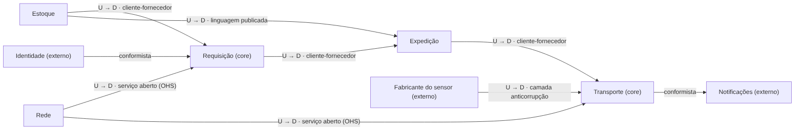

Relações entre os bounded contexts. U = upstream (fornece), D = downstream (consome). Fonte: [`contexto/mapa-de-contextos.mmd`](docs/arquitetura/contexto/mapa-de-contextos.mmd)

<details>
<summary>Ver código Mermaid</summary>

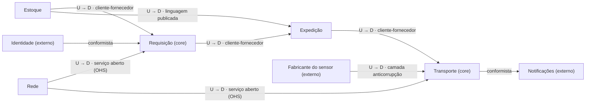

</details>

### B.1 · Agregado Requisição

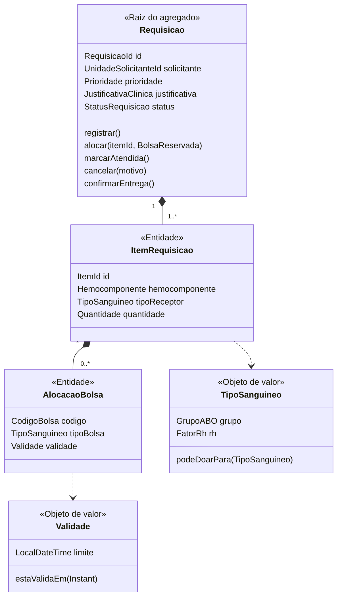

A raiz `Requisicao` protege as invariantes de compatibilidade (I1) e validade (I2). Fonte: [`contexto/agregado-requisicao.mmd`](docs/arquitetura/contexto/agregado-requisicao.mmd)

<details>
<summary>Ver código Mermaid</summary>

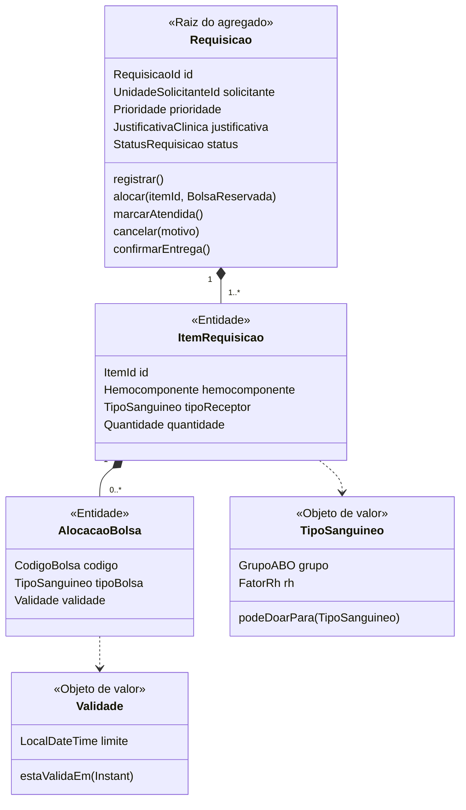

</details>

### C.2 · Regra de dependência das camadas

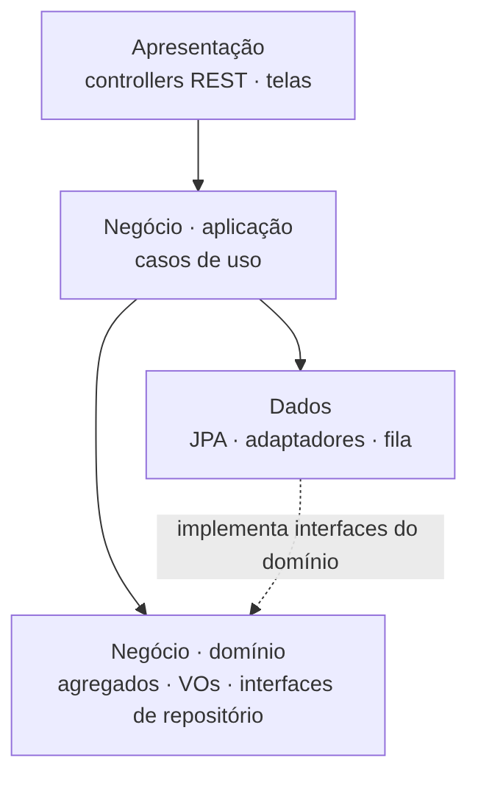

As dependências apontam para baixo; a camada de dados implementa as interfaces do domínio. Fonte: [`camadas/regra-de-dependencia.mmd`](docs/arquitetura/camadas/regra-de-dependencia.mmd)

<details>
<summary>Ver código Mermaid</summary>

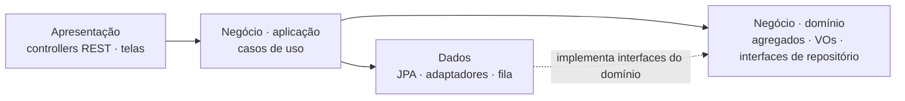

</details>

### D.2 · Microsserviços: comunicação e dados

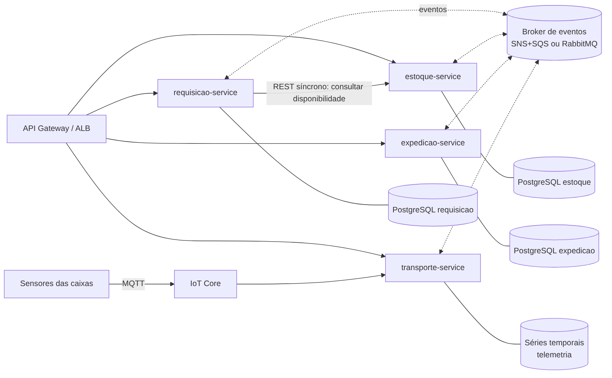

REST síncrono só para consulta de disponibilidade; mudanças de estado por eventos; um banco por serviço. Fonte: [`microsservicos/comunicacao.mmd`](docs/arquitetura/microsservicos/comunicacao.mmd)

<details>
<summary>Ver código Mermaid</summary>

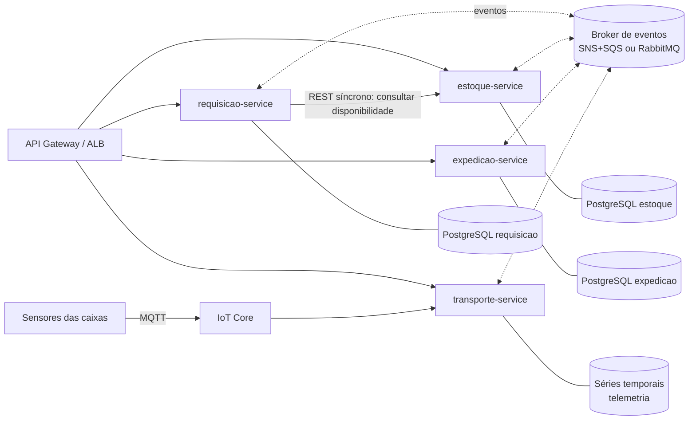

</details>

### D.3 · Saga "Atender requisição"

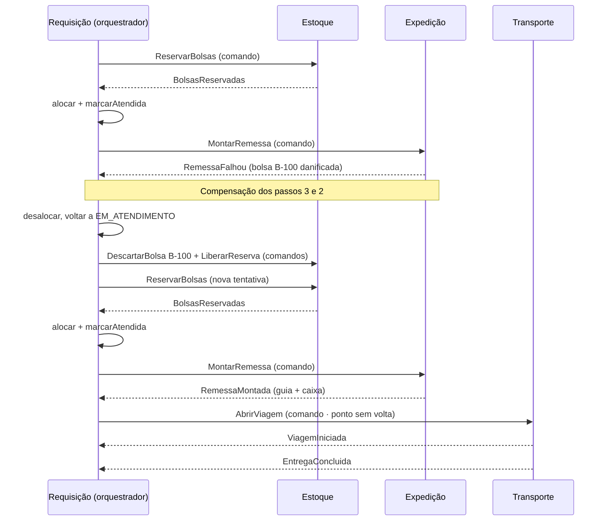

Saga orquestrada pela Requisição, com compensação quando a Expedição encontra uma bolsa danificada. Fonte: [`microsservicos/saga-atender-requisicao.mmd`](docs/arquitetura/microsservicos/saga-atender-requisicao.mmd)

<details>
<summary>Ver código Mermaid</summary>

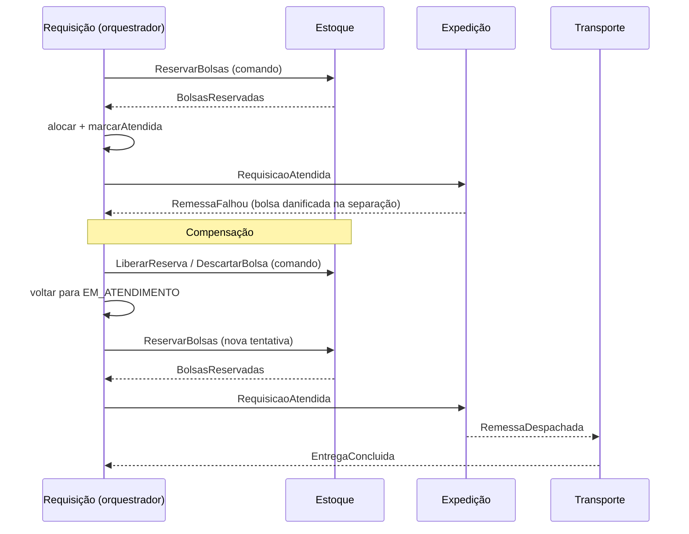

</details>

### E.3 · Cenário baixo (Render)

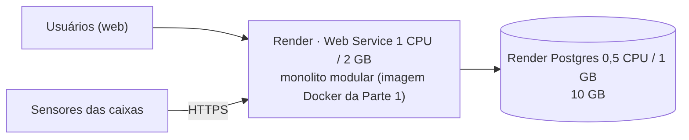

1 instância + 1 banco · US$ 47/mês · disponibilidade 99,0%. Fonte: [`cenarios/baixo.mmd`](docs/arquitetura/cenarios/baixo.mmd)

<details>
<summary>Ver código Mermaid</summary>

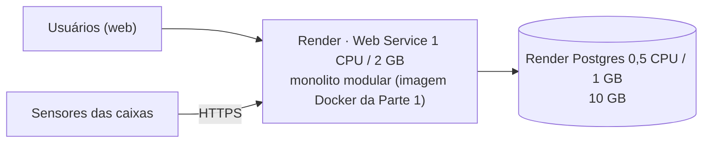

</details>

### E.3 · Cenário moderado (AWS, 2 zonas)

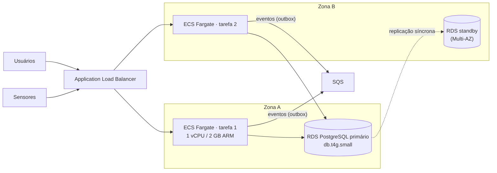

2 tarefas Fargate em zonas diferentes + RDS Multi-AZ · US$ 148,40/mês · 99,9%. Fonte: [`cenarios/moderado.mmd`](docs/arquitetura/cenarios/moderado.mmd)

<details>
<summary>Ver código Mermaid</summary>

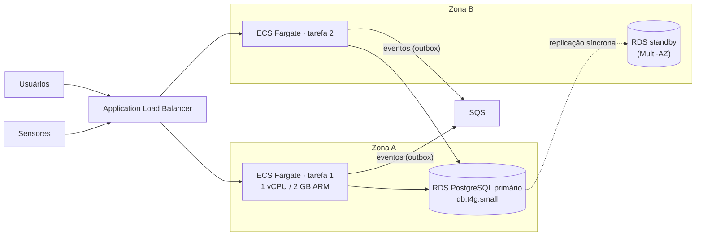

</details>

### E.3 · Cenário alto (AWS, autoscaling)

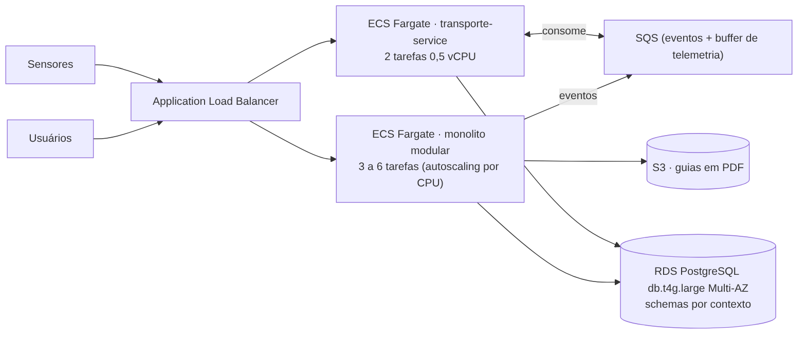

Monolito com 3–6 tarefas + transporte-service extraído · US$ 469,78/mês · 99,95%. Fonte: [`cenarios/alto.mmd`](docs/arquitetura/cenarios/alto.mmd)

<details>
<summary>Ver código Mermaid</summary>

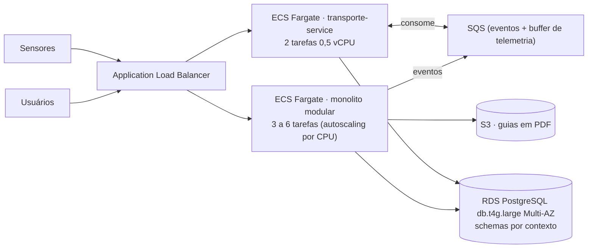

</details>
