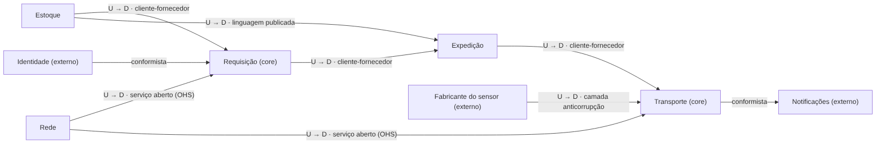
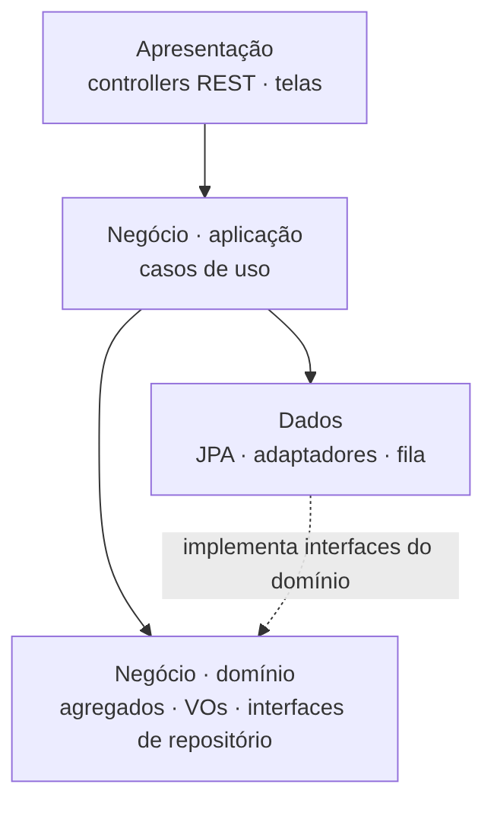
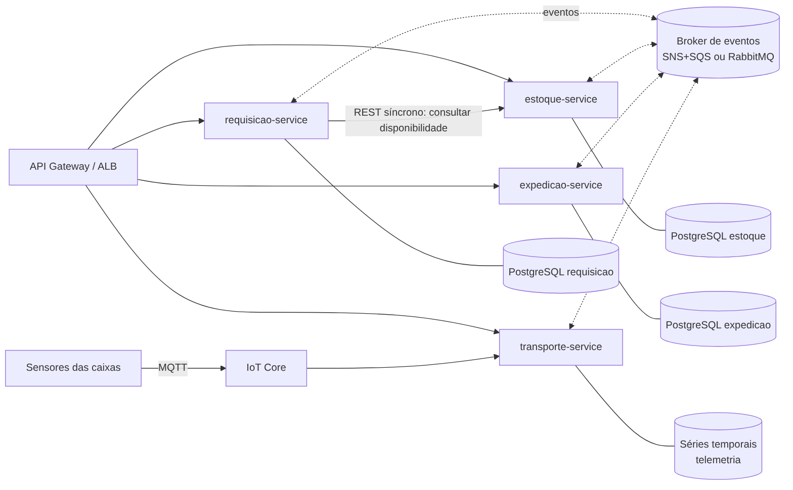
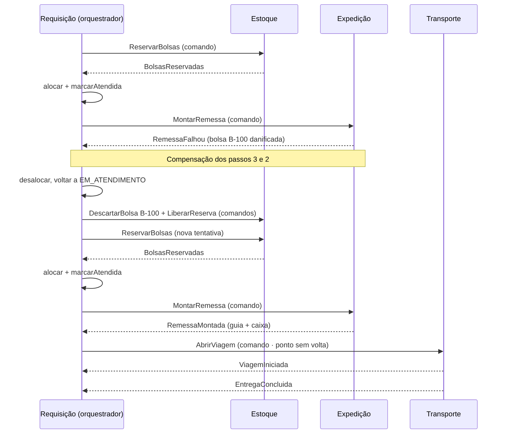
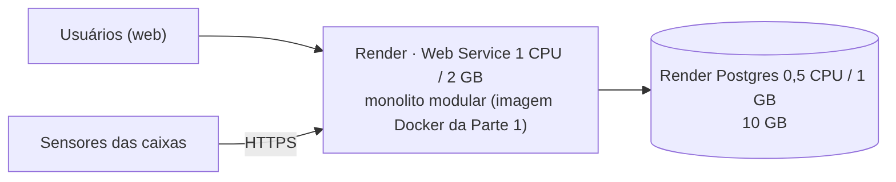
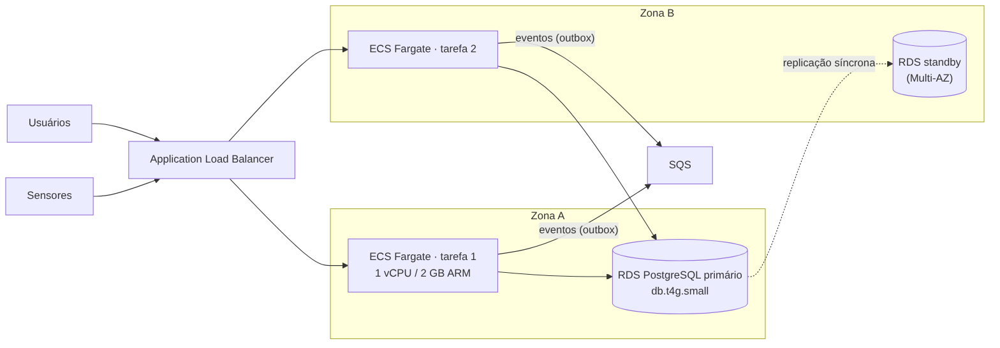
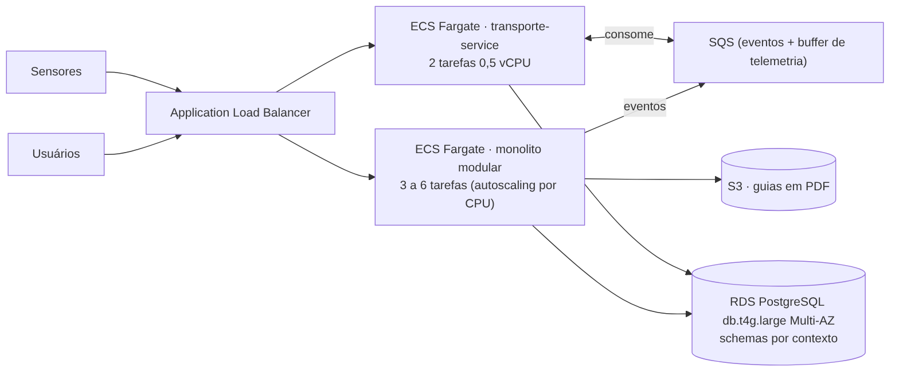

# Rota Vital — Trabalho U2 · Parte 2: Planejamento da remodelagem

Squad **Hemotrack** · Infraestrutura de Software · ADS · CESAR School · 2026.2

> Versão em PDF (10 páginas): [`docs/entregas/Hemotrack-Rota-Vital-Parte-2.pdf`](../entregas/Hemotrack-Rota-Vital-Parte-2.pdf)

## Identificação e premissas

O squad Hemotrack remodela o Rota Vital como um monolito modular em três camadas com cinco bounded contexts, projeta quatro microsserviços e orça três cenários entre US$ 47 e US$ 473 por mês.

| Item | Preencher |
| --- | --- |
| Squad | Hemotrack |
| Integrantes | Ewerton Guilherme da Silva (Product Owner) · Pablo Arthur Eustáquio de Lima, João Ricardo Alves de Brito, Lucas Aprigio dos Santos, Saulo Eduardo Almeida dos Santos (Backend) · Thiago Cardozo da Conceição, Eloi de Lima Sousa (Frontend / UI Design) |
| Repositório | [github.com/egs3-coder/Trabalho-U2-Parte-2-Planejamento-da-remodelagem](https://github.com/egs3-coder/Trabalho-U2-Parte-2-Planejamento-da-remodelagem) — pasta `docs/arquitetura/` |
| Disciplina | Infraestrutura de Software · ADS · CESAR School · 2026.2 |

**Premissas:** o Rota Vital coordena bolsas de sangue entre um hemocentro e hospitais: requisição → reserva no estoque → expedição em caixa térmica com sensor → transporte → recebimento. Stack da Parte 1: Java 21 + Spring Boot, PostgreSQL, Docker e GitHub Actions. Apenas dados sintéticos.

## A. Remodelagem do domínio com DDD

O coração do Rota Vital é atender a requisição com a bolsa certa, dentro da validade e sem quebrar a cadeia fria; o resto apoia isso ou é comprável pronto.

### A.1 Subdomínios

| Subdomínio | Tipo | Justificativa |
| --- | --- | --- |
| Atendimento de requisições | Core | Escolher bolsas compatíveis e mais próximas do vencimento, por prioridade, é o diferencial do produto. |
| Rastreabilidade da cadeia fria | Core | Provar que a bolsa viajou na faixa de temperatura é o que gera confiança no hemocentro e no hospital. |
| Gestão de estoque | Suporte | Específico do negócio, mas é controle de entrada, saída e validade. |
| Expedição e documentação | Suporte | Obrigatório, porém segue um procedimento padronizado. |
| Cadastro da rede | Suporte | Dado de referência com regras simples. |
| Identidade e acesso | Genérico | Resolvido por produto pronto (Keycloak, Cognito). |
| Notificações | Genérico | Envio de e-mail e SMS é commodity, contratado de um provedor. |

### A.2 Bounded contexts

| Contexto | Responsabilidade | Subdomínio |
| --- | --- | --- |
| **Estoque** | Registra bolsas, controla validade e status e reserva bolsas para requisições. | Gestão de estoque |
| **Requisição** | Recebe o pedido, aplica prioridade e compatibilidade e acompanha até o recebimento. | Atendimento (core) |
| **Expedição** | Separa as bolsas reservadas, acondiciona em caixa térmica e emite a guia. | Expedição |
| **Transporte** | Acompanha a viagem, recebe a telemetria e detecta excursões de temperatura. | Cadeia fria (core) |
| **Rede** | Mantém hospitais, unidades solicitantes, endereços e contatos. | Cadastro da rede |

### A.3 Glossário da linguagem ubíqua

| Termo | Contexto | Significado |
| --- | --- | --- |
| **Bolsa** | Estoque | Unidade de hemocomponente com número de doação, tipo sanguíneo, validade e status. |
| **Bolsa** | Expedição | Volume a acondicionar: só importam código de barras, posição na caixa e conferência. |
| **Entrega** | Requisição | Confirmação do hospital de que recebeu o pedido; encerra a requisição. |
| **Entrega** | Transporte | Chegada da caixa ao destino, com horário e última temperatura; encerra a viagem. |
| Tipo sanguíneo | Estoque, Requisição | Grupo ABO + fator Rh (ex.: O−). |
| Validade | Estoque | Data-limite de uso; bolsa vencida não pode ser reservada. |
| Reserva | Estoque | Bloqueio temporário de bolsas para uma requisição, com prazo de expiração. |
| Requisição | Requisição | Pedido de um hospital com itens, prioridade e justificativa clínica. |
| Prioridade | Requisição | Rotina, urgência ou emergência; define o prazo e a ordem na fila. |
| Guia de remessa | Expedição | Documento com as bolsas, origem, destino e responsável. |
| Leitura de telemetria | Transporte | Temperatura, hora e posição enviadas pelo sensor da caixa. |
| Excursão de temperatura | Transporte | Período fora da faixa permitida (ex.: 2–6 °C para hemácias). |

### A.4 Mapa de contextos



| Relação (upstream → downstream) | Tipo | Como funciona |
| --- | --- | --- |
| Estoque → Requisição | Cliente-fornecedor | Requisição pede reservas; Estoque mantém a API `reservar` e o evento `BolsasReservadas`. |
| Requisição → Expedição | Cliente-fornecedor | Expedição começa ao receber `RequisicaoAtendida`. |
| Estoque → Expedição | Linguagem publicada | Código ISBT 128 da bolsa como identificador comum. |
| Expedição → Transporte | Cliente-fornecedor | Transporte abre a viagem a partir de `RemessaDespachada`. |
| Sensor → Transporte | Camada anticorrupção | Adaptador traduz o payload do fabricante (°F) para `LeituraTelemetria` (°C). |
| Rede → Requisição e Transporte | Serviço aberto | API de consulta de unidades e endereços. |
| Identidade, Notificações | Conformista | O Rota Vital adota o modelo do provedor sem traduzir. |

**Eventos de domínio (opcional):** `RequisicaoRegistrada` e `RequisicaoAtendida` (Requisição), `BolsasReservadas` e `BolsaVencida` (Estoque), `RemessaDespachada` (Expedição), `TemperaturaForaDaFaixa` e `EntregaConcluida` (Transporte); cada um é consumido pelo contexto seguinte do fluxo.

## B. Modelo tático do contexto Requisição (core)

O agregado escolhido é a **Requisição**: nela o sistema decide se um pedido pode ser atendido, e a regra mais cara de errar (enviar bolsa incompatível ou vencida) fica protegida pela raiz.

### B.1 Agregado Requisição

| Elemento | Tipo | Conteúdo |
| --- | --- | --- |
| `Requisicao` | Raiz | id, solicitante, prioridade, justificativa, status. Métodos `registrar`, `alocar`, `marcarAtendida`, `cancelar`, `confirmarEntrega`. Única porta de entrada do agregado. |
| `ItemRequisicao` | Entidade (1..\* por requisição) | Hemocomponente, tipo sanguíneo do receptor e quantidade; pode ser atendido parcialmente. |
| `AlocacaoBolsa` | Entidade (0..\* por item) | Código, tipo e validade da bolsa reservada; refere o Estoque só pelo `CodigoBolsa`. |
| `TipoSanguineo`, `Prioridade`, `Validade`, `Quantidade`, `JustificativaClinica` | Objetos de valor | Imutáveis e autovalidados; `TipoSanguineo.podeDoarPara()` e `Validade.estaValidaEm()`. |

**Invariantes que a raiz protege**

1. **I1 — Compatibilidade:** só aceita bolsa cujo tipo seja compatível com o tipo do receptor do item.
2. **I2 — Validade na entrega:** a bolsa precisa estar válida no horário previsto de entrega (agora + prazo da prioridade).
3. **I3 — Quantidade:** um item nunca recebe mais bolsas do que pediu; a requisição tem ao menos um item.
4. **I4 — Emergência:** requisição de emergência exige justificativa clínica.
5. **I5 — Ciclo de vida:** REGISTRADA → EM\_ATENDIMENTO → ATENDIDA → EM\_TRANSPORTE → ENTREGUE; só fica ATENDIDA com todos os itens completos.

### B.2 História de usuário âncora

**Persona:** Carla, atendente do plantão noturno do hemocentro, atende sozinha os pedidos de emergência. **História:** *como* atendente, *quero* alocar bolsas a um item da requisição *para que* o hospital receba apenas bolsas compatíveis e dentro da validade (invariantes **I1** e **I2**).

**Critérios de aceite**

1. Item para receptor A+ aceita bolsa O− válida e passa a ter 1 bolsa alocada.
2. Item para receptor O− recusa bolsa A+ com "Tipo sanguíneo incompatível".
3. Em urgência (prazo de 4 h), bolsa que vence em 2 h é recusada com "Bolsa vence antes da entrega prevista".
4. Uma recusa não altera o status da requisição nem as alocações existentes.

### B.3 Cenário Gherkin (executado na Parte 3)

```gherkin
# language: pt
Funcionalidade: Alocar bolsas a uma requisição

  Contexto:
    Dado que agora são "2026-11-24 19:00"
    E existe a requisição "REQ-001" de prioridade "URGENCIA"
    E a requisição tem o item "ITEM-1" para receptor "A+" com quantidade 2

  Cenário: Alocar bolsa compatível e válida
    Quando a atendente alocar a bolsa "B-100" do tipo "O-" com validade "2026-12-10 00:00" ao item "ITEM-1"
    Então a alocação é aceita
    E o item "ITEM-1" tem 1 bolsa alocada

  Esquema do Cenário: Recusar bolsa que viola uma invariante
    Quando a atendente alocar a bolsa "<bolsa>" do tipo "<tipo>" com validade "<validade>" ao item "ITEM-1"
    Então a alocação é recusada com a mensagem "<mensagem>"
    E a requisição "REQ-001" continua com status "EM_ATENDIMENTO"

    Exemplos:
      | bolsa | tipo | validade         | mensagem                              |
      | B-200 | B+   | 2026-12-10 00:00 | Tipo sanguíneo incompatível           |
      | B-300 | O-   | 2026-11-24 21:00 | Bolsa vence antes da entrega prevista |
```

## C. Arquitetura em três camadas

Cada bounded context é um módulo com as mesmas três camadas; as dependências apontam para baixo e o domínio não importa Spring, JPA nem HTTP.

### C.1 O que fica em cada camada

| Camada | Contém | Exemplos |
| --- | --- | --- |
| **Apresentação** | Controllers REST, DTOs, validação de formato, telas web e app do motorista | `RequisicaoController`, `AlocarBolsaRequest` |
| **Negócio · aplicação** | Casos de uso: orquestram o domínio, abrem a transação, publicam eventos | `RegistrarRequisicao`, `AlocarBolsa` |
| **Negócio · domínio** | Agregados, entidades, objetos de valor, eventos e interfaces de repositório | `Requisicao`, `TipoSanguineo`, `RequisicaoRepository` |
| **Dados** | Repositórios JPA, banco, integrações (sensor, notificações) e fila | `RequisicaoRepositoryJpa`, `SensorTelemetriaAdapter` |

### C.2 Regra de dependência



- Cada camada só usa a de baixo: apresentação → aplicação → domínio e dados.
- O domínio é Java puro: a interface `RequisicaoRepository` fica no domínio e a implementação JPA fica em dados (inversão de dependência).
- Um contexto só fala com outro pela camada de aplicação ou por evento. Testes **ArchUnit** na esteira falham se `..dominio..` importar Spring, JPA ou `..apresentacao..`.

### C.3 Estrutura de pacotes

```
br.cesar.rotavital
├── estoque
│   ├── apresentacao   (EstoqueController)
│   ├── negocio
│   │   ├── aplicacao  (RegistrarBolsa, ConsultarEstoque, ReservarBolsas)
│   │   └── dominio    (Bolsa, Validade, Reserva, BolsaVencida, BolsaRepository)
│   └── dados          (BolsaRepositoryJpa)
├── requisicao
│   ├── apresentacao   (RequisicaoController)
│   ├── negocio
│   │   ├── aplicacao  (RegistrarRequisicao, AlocarBolsa, MarcarRequisicaoAtendida)
│   │   └── dominio    (Requisicao, ItemRequisicao, AlocacaoBolsa, Prioridade)
│   └── dados          (RequisicaoRepositoryJpa, EstoqueClient)
├── expedicao          apresentacao · negocio/aplicacao (MontarRemessa, EmitirGuia)
│                      · negocio/dominio (Remessa, CaixaTermica, GuiaRemessa) · dados
├── transporte         apresentacao · negocio/aplicacao (IniciarViagem, RegistrarLeitura)
│                      · negocio/dominio (Viagem, LeituraTelemetria) · dados (SensorTelemetriaAdapter)
└── rede               apresentacao · negocio/aplicacao (CadastrarUnidade)
                       · negocio/dominio (UnidadeSolicitante, Endereco) · dados
```

### C.4 Camada lógica × tier físico

Camada é organização do código; tier é onde o processo roda. As três camadas do servidor rodam no **mesmo** processo; a camada de dados (código dos repositórios) roda no tier de aplicação, e o tier de dados é o servidor de banco.

| Tier físico | O que roda | Camadas lógicas |
| --- | --- | --- |
| Cliente | Navegador (painéis do hemocentro e do hospital) e app do motorista | Telas da apresentação |
| Aplicação | Container Docker com o JAR Spring Boot (Render ou ECS Fargate) | Apresentação, negócio e dados |
| Dados | PostgreSQL gerenciado e, nos cenários maiores, a fila | Persistência |

## D. Projeção com microsserviços

Com microsserviços seriam quatro serviços, cada um com seu banco, conversando por eventos; a decisão para agora é manter o monolito modular e extrair primeiro o Transporte (ADR 0001).

### D.1 Quais contextos viram serviços

| Serviço | Contextos | Por quê |
| --- | --- | --- |
| `estoque-service` | Estoque | Dono da verdade das bolsas; resolve a concorrência de duas requisições pela mesma bolsa. |
| `requisicao-service` | Requisição + Rede | Core e muda com frequência; Rede é pequeno e só lido, então fica junto. |
| `expedicao-service` | Expedição | Outro ritmo de mudança (procedimentos, documentos) e outro usuário (expedidor). |
| `transporte-service` | Transporte | Carga muito diferente: milhares de leituras de telemetria por minuto; escala sozinho. |

Identidade e Notificações não viram serviços nossos: são produtos contratados.

### D.2 Comunicação e dados



- **REST síncrono** só quando o usuário espera a resposta na tela (consultar disponibilidade no Estoque).
- **Eventos assíncronos** (SNS + SQS) para toda mudança de estado entre contextos, com *outbox transacional* (ADR 0002); **MQTT** (IoT Core) para a telemetria.
- **Um banco por serviço:** nenhum serviço lê a tabela de outro. A Requisição guarda cópia da bolsa alocada e aceita consistência eventual; o Transporte usa um banco de séries temporais.

### D.3 Saga "Atender requisição" (orquestrada pela Requisição)

| Passo | Serviço | Ação local | Compensação se um passo seguinte falhar |
| --- | --- | --- | --- |
| 1 | Requisição | Registra a requisição (EM\_ATENDIMENTO) | Cancelar e notificar o hospital |
| 2 | Estoque | Reserva as bolsas (expira em 30 min) | Liberar a reserva |
| 3 | Requisição | Aloca as bolsas e marca ATENDIDA | Desalocar e voltar a EM\_ATENDIMENTO |
| 4 | Expedição | Monta a remessa e emite a guia | Cancelar a guia e devolver as bolsas |
| 5 | Transporte | Abre a viagem e despacha | Sem volta (*pivot*): falha vira requisição de reposição |

**Exemplo de falha:** na separação, a Expedição acha a bolsa B-100 com a embalagem rompida e publica `RemessaFalhou`. A Requisição compensa os passos 3 e 2 (desaloca, pede o descarte de B-100 e libera as demais) e reinicia no passo 2; sem estoque, notifica o hospital.



### D.4 Comparação para o Rota Vital

| Critério | Monolito modular | Microsserviços | Serverless (opcional) |
| --- | --- | --- | --- |
| Unidade de deploy | 1 imagem Docker | 4 imagens independentes | 1 função por gatilho |
| Escala | O sistema inteiro junto | Cada serviço sozinho | Automática por evento, até zero |
| Consistência | Forte (uma transação ACID) | Eventual, com saga | Eventual; estado fora da função |
| Custo (moderado) | Menor: 2 containers + 1 banco | Maior: 4+ serviços, broker, bancos | Baixo com pouca carga; soma gateway e RDS Proxy |
| Operação | Baixa: 1 esteira, 1 log | Alta: rastreamento distribuído, várias esteiras | Média: muitos gatilhos, depuração difícil |

**Serverless (opcional):** viram funções a emissão da guia em PDF ao receber `RequisicaoAtendida`, o processamento de cada leitura de telemetria e a rotina diária de bolsas vencidas. Não viram o agregado Requisição e as reservas (precisam de transação e conexões ao banco; cold start atrasaria uma emergência) nem relatórios longos (limite de 15 min).

### D.5 ADRs

Arquivos em `docs/arquitetura/adr/0001-decomposicao.md` e `0002-eventos-com-outbox.md`.

**ADR 0001: Decomposição do Rota Vital** · Status: aceito

- **Contexto:** squad de 7 pessoas, um repositório e uma esteira; pico de 3 a 120 req/s e só a telemetria com volume alto; fronteiras ainda mudando.
- **Decisão:** monolito modular com cinco módulos em três camadas, ligados por casos de uso e eventos. Transporte é o primeiro a ser extraído, acima de \~50 leituras/s.
- **Consequências:** melhora deploy, custo e transação ACID entre reserva e alocação; piora porque escala em bloco e exige ArchUnit para manter as fronteiras. Descartada: microsserviços já, caros demais para a carga atual.

**ADR 0002: Eventos entre contextos com outbox transacional** · Status: aceito

- **Contexto:** gravar no banco e publicar na fila em dois passos pode perder o evento e deixar uma bolsa reservada para sempre.
- **Decisão:** o caso de uso grava o evento numa tabela `outbox` na mesma transação; um publicador envia ao broker; consumidores são idempotentes.
- **Consequências:** nenhum evento perdido e mesmo código no monolito e nos microsserviços; piora com duplicatas a tratar e uma tabela a limpar. Descartada: publicar direto no broker, que não é atômico com o banco.

## E. Três cenários com orçamento

O custo mensal vai de US$ 47 (baixo) a US$ 473 (alto), mas o custo por pedido cai de US$ 0,0104 para US$ 0,0013, porque a infraestrutura fixa se dilui em mais requisições.

### E.1 Premissas de carga

| Premissa | Baixo (piloto) | Moderado (estadual) | Alto (regional) |
| --- | --- | --- | --- |
| Abrangência | 1 hemocentro, 20 hospitais (Recife) | 5 unidades, 150 hospitais (PE) | 9 hemocentros, 1.200 hospitais (Nordeste) |
| Usuários cadastrados | 60 | 600 | 5.000 |
| Pedidos por dia / por mês | 150 / 4.500 | 1.500 / 45.000 | 12.000 / 360.000 |
| Caixas em trânsito no pico (1 leitura a cada 30 s) | 10 | 80 | 600 |
| **Pico de requisições por segundo (λ)** | **3 req/s** | **20 req/s** | **120 req/s** |
| Tempo de resposta W / tempo no banco W\_db | 0,20 s / 0,05 s | 0,20 s / 0,05 s | 0,25 s / 0,05 s |
| **Disponibilidade desejada** | 99,0% (7,3 h fora/mês) | 99,9% (44 min/mês) | 99,95% (22 min/mês) |

**Como o pico foi estimado (moderado):** 1.500 pedidos × 40 chamadas HTTP = 60.000 chamadas em 12 h = 1,4 req/s; fator de pico 10 = 14 req/s; + 80 caixas ÷ 30 s = 2,7 leituras/s; arredondado para 20 req/s. **Capacidade adotada:** uma instância de 1 vCPU atende 7 requisições simultâneas (70% de 10), a confirmar no teste de carga da Parte 3.

### E.2 Lei de Little

**L = λ × W** (requisições em atendimento ao mesmo tempo) · **instâncias = L ÷ 7, arredondado para cima** · **L\_db = λ × W\_db** (conexões com o banco ocupadas ao mesmo tempo)

| Cenário | L = λ × W | Instâncias pela conta | Instâncias adotadas | L\_db = λ × W\_db | Conexões no banco (pool) |
| --- | --- | --- | --- | --- | --- |
| Baixo | 3 × 0,20 = **0,6** | 1 | 1 (99,0% tolera reinício) | 0,15 | 5 |
| Moderado | 20 × 0,20 = **4** | 1 | 2 (N+1 em 2 zonas, para 99,9%) | 1 | 10 (2 × 5) |
| Alto | 120 × 0,25 = **30** | 5 | 3 a 6 com autoscaling (5 + 1 no pico) + 2 do Transporte | 6 | até 70 (6 × 10 + 2 × 5) |

O gargalo não é o banco (L\_db ≤ 6), e sim a disponibilidade: no moderado a carga cabe em 1 instância, mas 99,9% exige uma segunda em outra zona.

### E.3 Diagramas e o que muda

**Baixo — Render (PaaS):** uma instância e um banco.



**Moderado — AWS em duas zonas:** load balancer, 2 tarefas Fargate e RDS Multi-AZ.



**Alto — AWS com autoscaling:** monolito com 3 a 6 tarefas e o Transporte extraído.



| Mudança | Baixo → Moderado | Moderado → Alto |
| --- | --- | --- |
| Provedor | Render → AWS (2 zonas e banco Multi-AZ para 99,9%) | Continua AWS |
| Aplicação | 1 → 2 instâncias atrás de um load balancer | 3–6 com autoscaling; Transporte vira serviço (ADR 0001) |
| Banco | 1 GB sem réplica → db.t4g.small com standby | db.t4g.large (8 GB) e 100 GB |
| Eventos e operação | Em memória → SQS; logs no CloudWatch | SQS absorve as rajadas de telemetria; guias no S3 |

### E.4 Orçamento por cenário

Preços on-demand em dólar, conferidos pelo squad em **12/11/2026** na página oficial do Render e na **AWS Pricing Calculator** (uma estimativa pública por cenário, linkada em cada item). A calculadora não desconta cotas gratuitas, e 730 h = 1 mês.

**Baixo — Render (Oregon, região onde o squad já hospeda o Rota Vital)**

| Item | Qtd. | Preço unit. | US$/mês | Região | Fonte | Data |
| --- | --- | --- | --- | --- | --- | --- |
| Web Service 1 CPU / 2 GB (`1c-2g`) | 1 | 25,00/mês | 25,00 | Oregon | [render.com/pricing](https://render.com/pricing) | 12/11/26 |
| Postgres 0,5 CPU / 1 GB (`0.5c-1g`) | 1 | 19,00/mês | 19,00 | Oregon | [render.com/pricing](https://render.com/pricing) | 12/11/26 |
| Armazenamento Postgres | 10 GB | 0,30/GB | 3,00 | Oregon | [render.com/pricing](https://render.com/pricing) | 12/11/26 |
| Workspace Hobby e banda (inclusa) | 1 | 0,00 | 0,00 | — | [render.com/pricing](https://render.com/pricing) | 12/11/26 |
| **Total · custo por pedido (4.500)** |  |  | **47,00 · 0,0104** |  |  |  |

**Moderado — AWS us-east-1** · [estimativa pública na AWS Pricing Calculator](https://calculator.aws/#/estimate?id=71d5f083738612902c899bf5a25a2fd44c668a7d)

| Item | Qtd. | Preço unit. | US$/mês | Região | Fonte | Data |
| --- | --- | --- | --- | --- | --- | --- |
| Fargate ARM (vCPU + memória) | 2 tarefas × 1 vCPU / 2 GB × 730 h | 0,03238/vCPU-h · 0,00356/GB-h | 57,66 | us-east-1 | [AWS Calculator](https://calculator.aws/#/estimate?id=71d5f083738612902c899bf5a25a2fd44c668a7d) | 12/11/26 |
| Load balancer (ALB) | 730 h + 1 LCU | 0,0225/h · 0,008/LCU-h | 22,27 | us-east-1 | [AWS Calculator](https://calculator.aws/#/estimate?id=71d5f083738612902c899bf5a25a2fd44c668a7d) | 12/11/26 |
| RDS PostgreSQL db.t4g.small Multi-AZ | 730 h | 0,065/h | 47,45 | us-east-1 | [AWS Calculator](https://calculator.aws/#/estimate?id=71d5f083738612902c899bf5a25a2fd44c668a7d) | 12/11/26 |
| RDS gp3 Multi-AZ | 20 GB | 0,23/GB | 4,60 | us-east-1 | [AWS Calculator](https://calculator.aws/#/estimate?id=71d5f083738612902c899bf5a25a2fd44c668a7d) | 12/11/26 |
| IPv4 público | 4 × 730 h | 0,005/h | 14,60 | us-east-1 | [AWS Calculator](https://calculator.aws/#/estimate?id=71d5f083738612902c899bf5a25a2fd44c668a7d) | 12/11/26 |
| SQS Standard | 1,1 M req | 0,40/M | 0,44 | us-east-1 | [AWS Calculator](https://calculator.aws/#/estimate?id=71d5f083738612902c899bf5a25a2fd44c668a7d) | 12/11/26 |
| CloudWatch Logs (ingestão + 1 mês) | 10 GB | 0,50/GB | 5,05 | us-east-1 | [AWS Calculator](https://calculator.aws/#/estimate?id=71d5f083738612902c899bf5a25a2fd44c668a7d) | 12/11/26 |
| **Total · custo por pedido (45.000)** |  |  | **152,07 · 0,0034** |  |  |  |

**Alto — AWS us-east-1** · [estimativa pública na AWS Pricing Calculator](https://calculator.aws/#/estimate?id=e9376074563bc3ece0ea5427d2302774428e035e)

| Item | Qtd. | Preço unit. | US$/mês | Região | Fonte | Data |
| --- | --- | --- | --- | --- | --- | --- |
| Fargate ARM monolito | 4 tarefas × 1 vCPU / 2 GB × 730 h | 0,03238/vCPU-h · 0,00356/GB-h | 115,34 | us-east-1 | [AWS Calculator](https://calculator.aws/#/estimate?id=e9376074563bc3ece0ea5427d2302774428e035e) | 12/11/26 |
| Fargate ARM transporte-service | 2 tarefas × 0,5 vCPU / 1 GB × 730 h | 0,03238/vCPU-h · 0,00356/GB-h | 28,84 | us-east-1 | [AWS Calculator](https://calculator.aws/#/estimate?id=e9376074563bc3ece0ea5427d2302774428e035e) | 12/11/26 |
| Load balancer (ALB) | 730 h + 5 LCU | 0,0225/h · 0,008/LCU-h | 45,63 | us-east-1 | [AWS Calculator](https://calculator.aws/#/estimate?id=e9376074563bc3ece0ea5427d2302774428e035e) | 12/11/26 |
| RDS PostgreSQL db.t4g.large Multi-AZ | 730 h | 0,258/h | 188,34 | us-east-1 | [AWS Calculator](https://calculator.aws/#/estimate?id=e9376074563bc3ece0ea5427d2302774428e035e) | 12/11/26 |
| RDS gp3 Multi-AZ | 100 GB | 0,23/GB | 23,00 | us-east-1 | [AWS Calculator](https://calculator.aws/#/estimate?id=e9376074563bc3ece0ea5427d2302774428e035e) | 12/11/26 |
| IPv4 público | 8 × 730 h | 0,005/h | 29,20 | us-east-1 | [AWS Calculator](https://calculator.aws/#/estimate?id=e9376074563bc3ece0ea5427d2302774428e035e) | 12/11/26 |
| SQS Standard (eventos + telemetria) | 47,5 M req | 0,40/M | 19,00 | us-east-1 | [AWS Calculator](https://calculator.aws/#/estimate?id=e9376074563bc3ece0ea5427d2302774428e035e) | 12/11/26 |
| CloudWatch Logs (ingestão + 1 mês) | 45 GB | 0,50/GB | 22,70 | us-east-1 | [AWS Calculator](https://calculator.aws/#/estimate?id=e9376074563bc3ece0ea5427d2302774428e035e) | 12/11/26 |
| S3 Standard (guias em PDF) | 36 GB | 0,023/GB | 0,83 | us-east-1 | [AWS Calculator](https://calculator.aws/#/estimate?id=e9376074563bc3ece0ea5427d2302774428e035e) | 12/11/26 |
| **Total · custo por pedido (360.000)** |  |  | **472,88 · 0,0013** |  |  |  |

**Fora do orçamento:** transferência para a internet, domínio, ambiente de homologação (cerca de +50%) e suporte pago. **Região:** em São Paulo (sa-east-1) o banco custaria cerca do dobro ([db.t4g.large: US$ 201 contra US$ 94/mês, Single-AZ](https://www.bytebase.com/dbcost/rds/instance/db.t4g.large.md)); com dados sintéticos, o squad escolheu us-east-1, a rever pela LGPD em produção real.

## Uso de IA

Conforme o PO-CESAR-021 (categoria Condicionado). Apenas dados sintéticos do Rota Vital foram usados.

| Quem / ferramenta | O que fez | Como foi validado |
| --- | --- | --- |
| Claude (Anthropic) | Estrutura e redação do documento, subdomínios, glossário, mapa de contextos, agregado e Gherkin, arquitetura em camadas, projeção com microsserviços, ADRs, diagramas Mermaid, contas da Lei de Little, fórmulas da planilha e slides | Conteúdo revisado pelo squad antes da entrega; contas conferidas na planilha `orcamento.xlsx` |
| **Squad (manual, sem IA)** | Conferência de todos os preços: montagem das duas estimativas na **AWS Pricing Calculator** (moderado e alto, us-east-1) serviço a serviço e consulta de **render.com/pricing**; levantamento dos valores lançados na planilha | Preço unitário de cada item comparado com o da calculadora oficial em 12/11/2026; a divergência encontrada no RDS db.t4g.small (0,064 → 0,065 USD/h) foi corrigida; links públicos das estimativas na seção E.4 |
| Cucumber-JVM | Execução do cenário Gherkin da seção B | Na Parte 3 |

Nenhum preço sugerido por IA foi usado: todos os valores do orçamento vêm das fontes oficiais consultadas pelo squad.

## Referências

EVANS, E. *Domain-Driven Design*, 2003 · VERNON, V. *Implementing Domain-Driven Design*, 2013 · NEWMAN, S. *Building Microservices*, 2. ed., 2021 · JONAS, E. et al. *A Berkeley View on Serverless Computing*, 2019 · NYGARD, M. *Documenting Architecture Decisions*, 2011 · Slides das aulas 006 e 007, CESAR School, 2026.2. Diagramas, planilha e ADRs em `docs/arquitetura/` no repositório.
